<p align="center">
  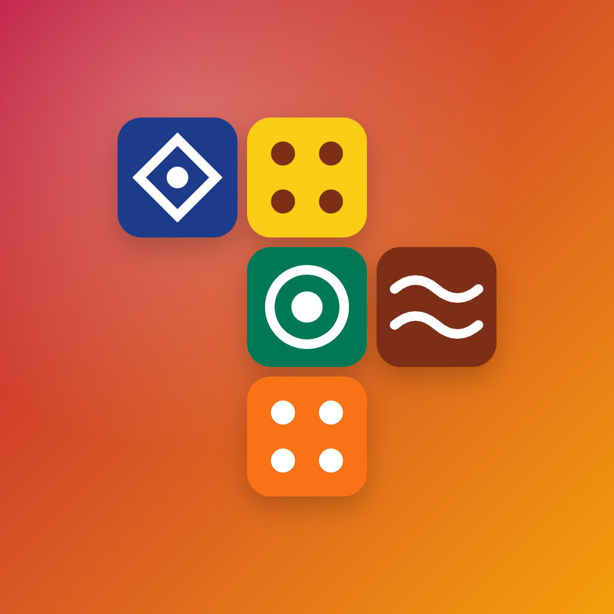
</p>

<h1 align="center">Ankara Blocks</h1>

<p align="center">
  <strong>An endless block puzzle wrapped in Ankara patterns.</strong><br />
  Drag chunky wax-print blocks onto the board, fill a row or column, and watch it burst.
</p>

<p align="center">
  
  
  
  
  
</p>

<p align="center">
  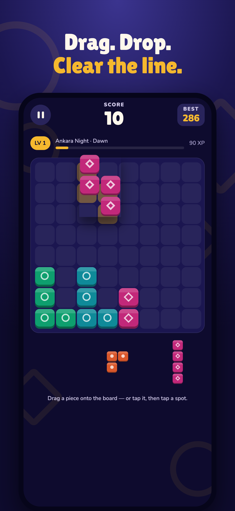
  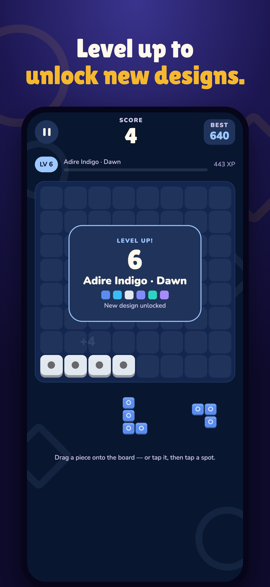
  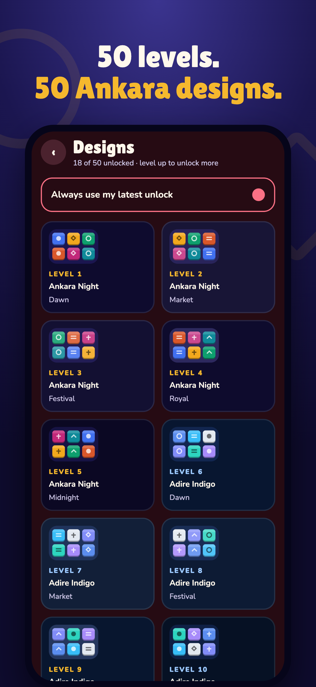
  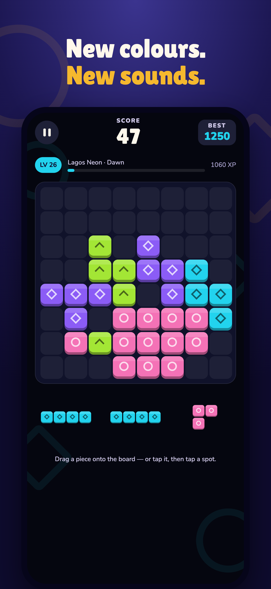
  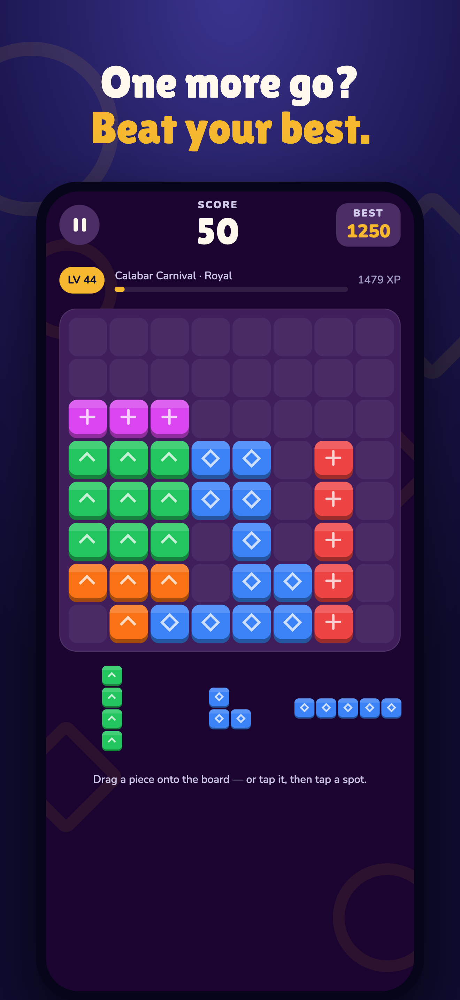
</p>

---

## The game

Three pieces at a time. An 8 × 8 board. Fill a full row or column to clear it; clear lines on back-to-back moves to build a combo; empty the whole board for a perfect clear. The game is endless — it ends only when none of your pieces fit — and every point you score is XP towards the next of **50 levels**, each with its own fabric design.

Every block is a little piece of wax-print fabric with its own motif (dot, diamond, ring, bars, cross or chevron), so colour is never the only cue.

## Features

| | |
|---|---|
| **50 levels, 50 designs** | Lifetime XP unlocks a new design every level across ten fabric families — Ankara Night, Adire Indigo, Kente Gold, Aso-Oke Coral, Bògòlan Earth, Lagos Neon, Harmattan Haze, Ọ̀ṣun River, Calabar Carnival and Savannah Dusk — each in five variants (Dawn → Midnight). Level up mid-game for a celebration and an instant makeover. Revisit any unlocked design in **Designs**. |
| **New sounds as you level** | Ten original instrument packs — wood, marimba, kalimba, agogo, udu, neon synth, shaker, water drops, steel pan and talking drum — a new one every five levels. |
| **Music** | *Victory at the Summit* loops underneath (switch it off in the pause menu). |
| **Fair and harder over time** | Every new tray is guaranteed to contain a piece that fits; big pieces get more common as you level up. |
| **Drag and drop** | Pieces lift and grow to board size as you drag, float above your finger so you can see where they'll land, and snap into place. A gold ghost shows the landing spot (red if it won't fit), and rows or columns about to clear light up. |
| **Tap to place** | Prefer tapping? Tap a piece, then tap a spot. Also works with VoiceOver / TalkBack. |
| **Juice** | Lines sweep away left-to-right and burst into fabric-coloured confetti; double and triple clears shake the screen and pop a combo banner. |
| **Sound + haptics** | Every move has a sound from the current pack plus a haptic. Music, sound and haptics can each be switched off. |
| **Scoring** | 1 point per block, 10 × lines² for clears, multiplied by your combo streak, and a 100-point perfect-clear bonus. Floating "+N" pop-ups and a combo chip keep you chasing. Best score and XP are saved on the device. |
| **Pause & game over** | A pause sheet (music, sound, haptics, designs, restart, how to play) and a game-over sheet with your score, *New best!*, XP earned, level progress and Share. |
| **How to play** | Four quick cards on first launch, drawn with real game blocks. Skippable. |
| **Accessible** | Respects Reduce Motion (no shake or confetti), 44 pt touch targets, screen-reader labels for every cell and piece, and motifs so colour isn't the only signal. |

## Screens

<table>
  <tr>
    <td align="center"><br /><sub>Dragging a piece</sub></td>
    <td align="center">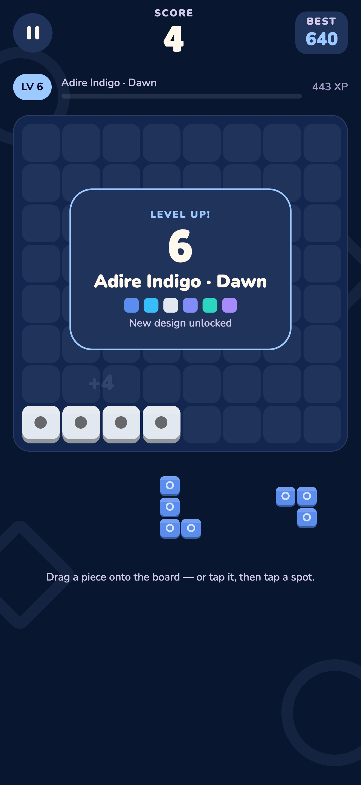<br /><sub>Level up</sub></td>
    <td align="center">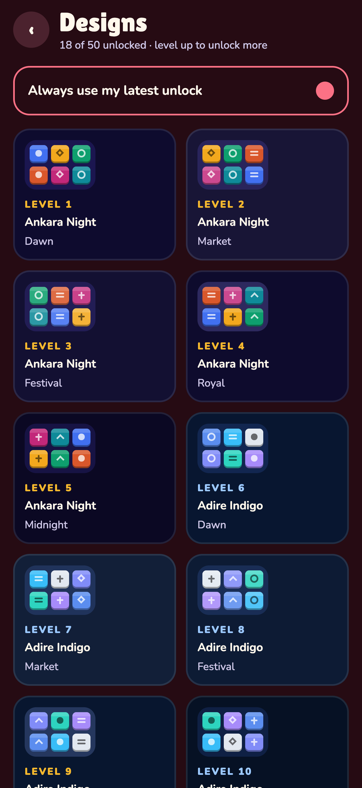<br /><sub>Designs</sub></td>
    <td align="center">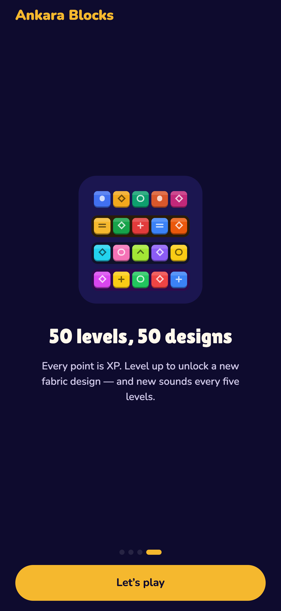<br /><sub>How to play</sub></td>
  </tr>
  <tr>
    <td align="center">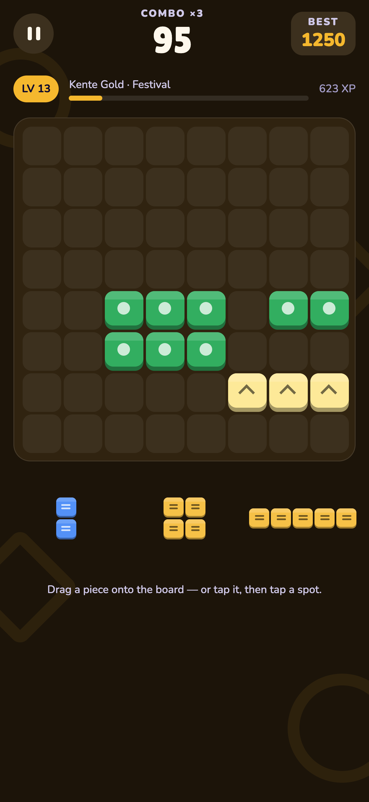<br /><sub>Level 13 · Kente Gold</sub></td>
    <td align="center">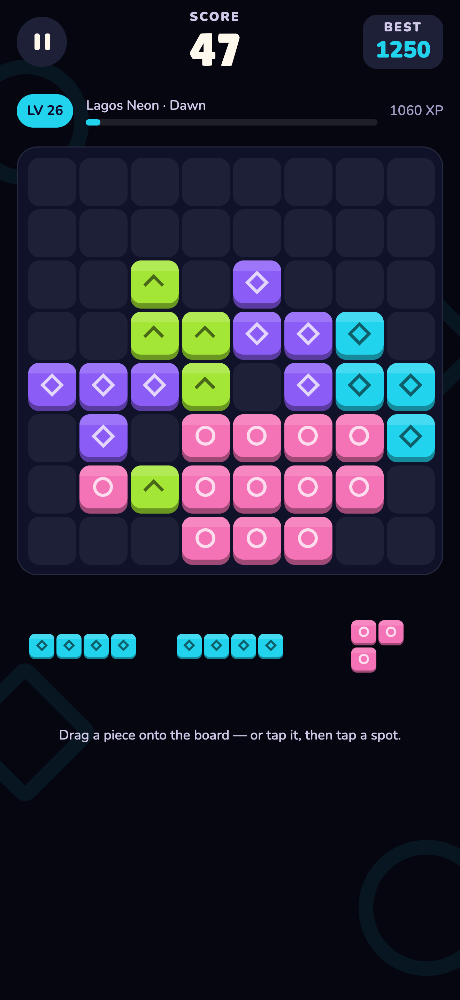<br /><sub>Level 26 · Lagos Neon</sub></td>
    <td align="center">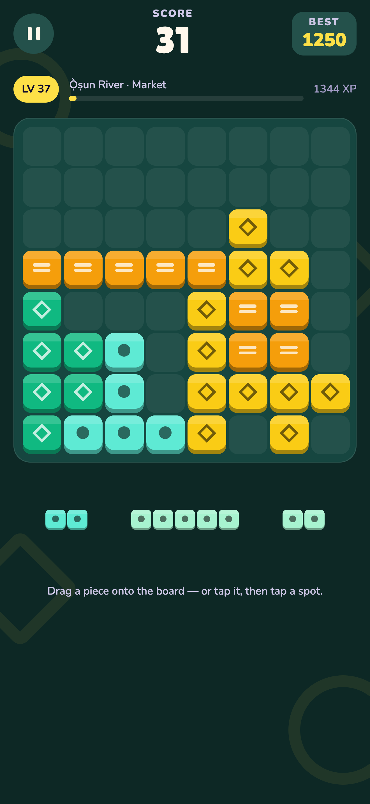<br /><sub>Level 37 · Ọ̀ṣun River</sub></td>
    <td align="center">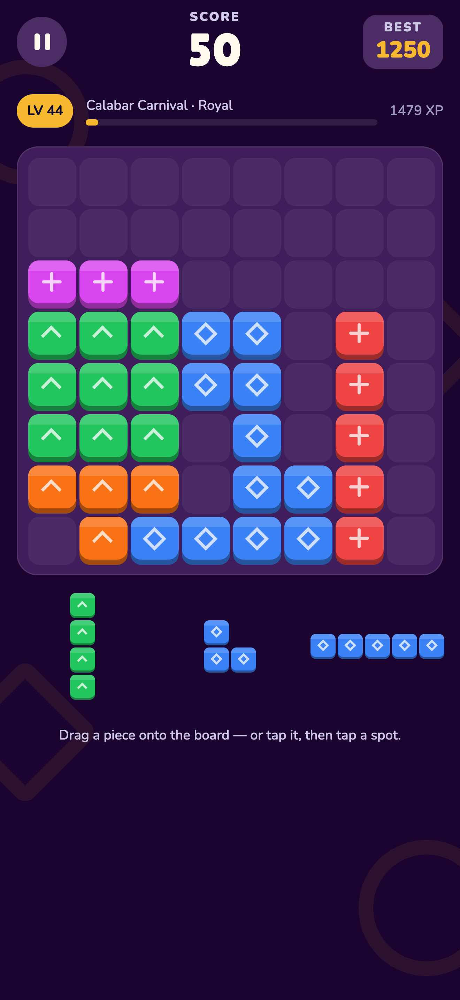<br /><sub>Level 44 · Calabar Carnival</sub></td>
  </tr>
</table>

## Design

The visual direction — **"Ankara Night Market"** — is documented in [`REDESIGN_NOTES.md`](REDESIGN_NOTES.md): deep indigo night, six wax-print block colours (each checked at ≥ 3:1 contrast against the board), gold for the score and actions, Lilita One for display type and Nunito for UI. All colours, type, spacing, radii, shadows, springs and durations live in [`src/theme/tokens.ts`](src/theme/tokens.ts).

## Tech stack

- **Expo SDK 58** · React Native 0.88 · React 19.3 · **TypeScript** (strict) · **Expo Router**
- **Reanimated 4** (springs, sweeps, confetti, shake) and **Gesture Handler 3** (hook-based `usePanGesture`; the drag runs on the UI thread)
- `expo-audio` (music + sound effects) · `expo-haptics` · `@expo-google-fonts/lilita-one` + `nunito`
- **Jest** + `jest-expo` + **React Native Testing Library**

## Project structure

```
src/
  app/
    index.tsx          the game: board, tray, effects, sheets
    how-to-play.tsx    first-launch cards
    designs.tsx        your unlocked designs
  game/
    engine.ts          pure rules: placement, clears, scoring, game over
    tray-piece.tsx     draggable / tappable tray piece
    block.tsx          the wax-print block
    effects.tsx        clear sweep, confetti, combo banner
    sheets.tsx         pause and game-over sheets
    feedback.ts        music, sound packs, haptics, player settings
    themes.ts          the 50 level designs
    progress.ts        XP curve and levels
  theme/tokens.ts      design tokens
assets/sfx/            10 instrument packs + shared sounds (tool/make-sfx.py)
assets/music/          background music
__tests__/             engine + gameplay tests
docs/screenshots/      store/ and screens/
```

## Getting started

```bash
npm install
npx expo start          # press i for the iOS Simulator, a for Android
```

### Tests

```bash
npm test                # 32 tests
npx tsc --noEmit
npx expo lint
```

The levels suite checks all 50 designs (unique names, every block ≥ 3:1 contrast against its board, readable accents, a sound pack for each), the XP curve, fair dealing even with one free cell, and that big pieces get more common with level. The engine suite covers placement (bounds, overlaps), scoring, single and crossing row/column clears with combo multipliers, game-over detection and the tray. The gameplay suite plays real moves through the screens: first-launch How to play and Skip, tap-to-place, refusing a move onto a filled cell, a full-row perfect clear (+110 and a fresh tray), saving the best score, levelling up mid-game with the celebration, choosing a design, pausing and restarting, and remembering settings.

> Reanimated 4's official Jest mock still loads native initialisers, so tests map it to a small stand-in in `test/reanimated-mock.js`.

### Regenerating the sounds

```bash
python3 tool/make-sfx.py
```

## Music

*Victory at the Summit* — source and licence: **TODO (add the credit here)**.

## Roadmap

- [ ] Daily challenge board and streaks
- [ ] More block skins (kente, adire)
- [ ] Rewarded "continue" ad (no interstitials)
- [ ] Android preview build (EAS) and TestFlight

## Author

Built by **Olateju Olamide Emmanuel** — mobile developer & ML engineer.
[Portfolio](https://tejusportfolio.vercel.app) · [GitHub](https://github.com/tejHacks) · [LinkedIn](https://www.linkedin.com/in/olateju-olamide-22314a292/)

## License

MIT — see [LICENSE](LICENSE).
