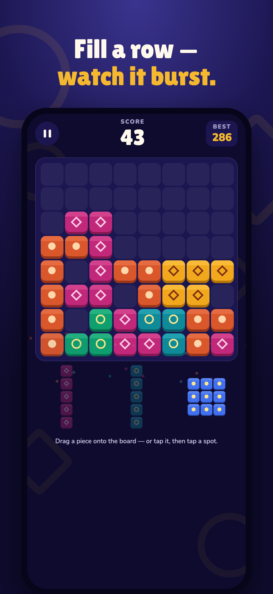
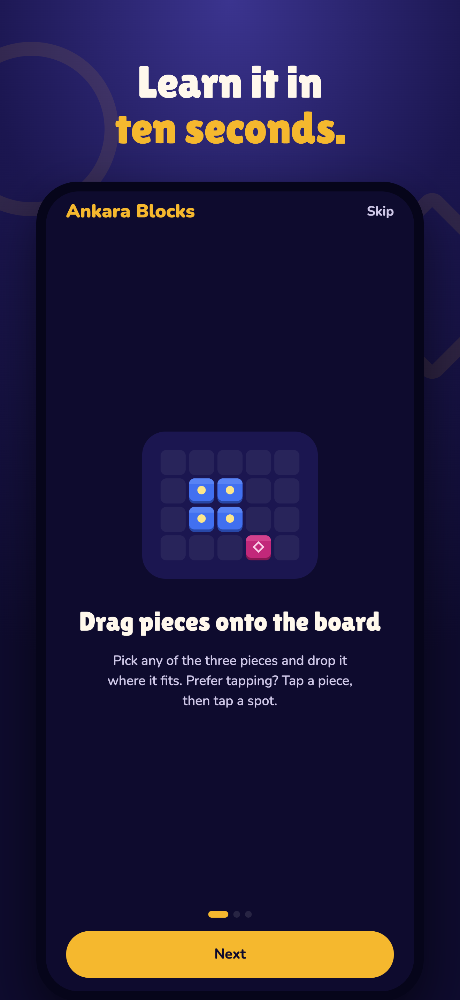
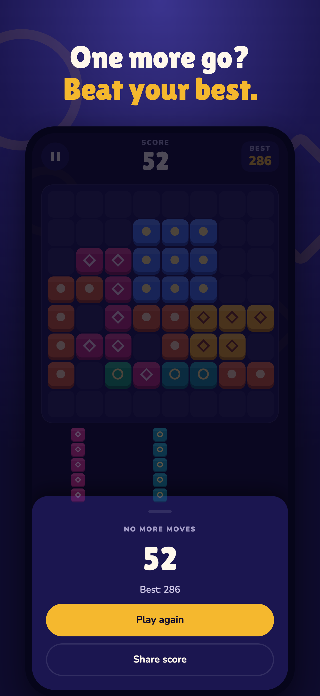
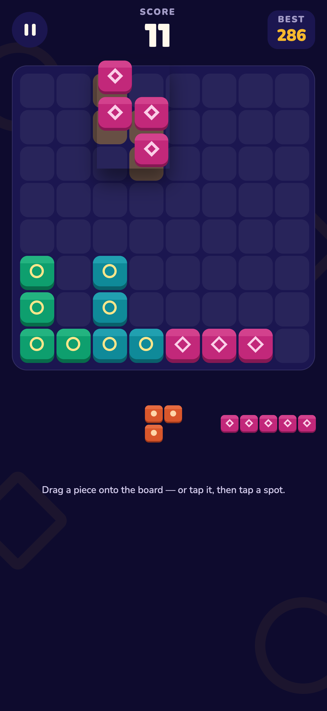
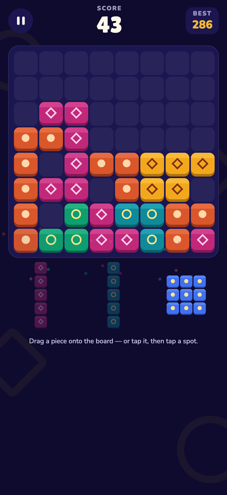
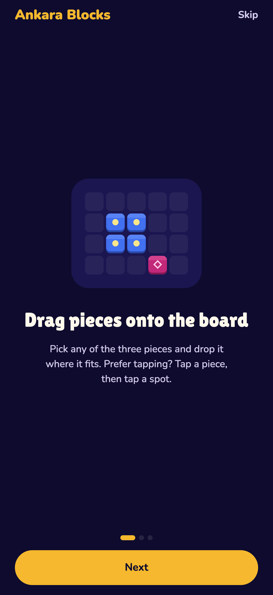
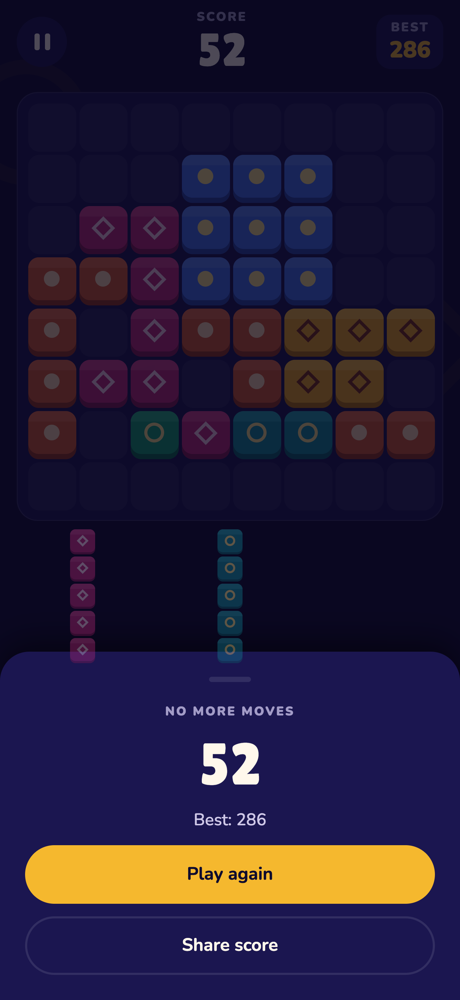

<p align="center">
  
</p>

<h1 align="center">Ankara Blocks</h1>

<p align="center">
  <strong>An endless block puzzle wrapped in Ankara patterns.</strong><br />
  Drag chunky wax-print blocks onto the board, fill a row or column, and watch it burst.
</p>

<p align="center">
  
  
  
  
  
</p>

<p align="center">
  
  
  
  
</p>

---

## The game

Three pieces at a time. An 8 × 8 board. Fill a full row or column to clear it; clear lines on back-to-back moves to build a combo. The game ends when none of your pieces fit — then you go again, because you were *this* close.

Every block is a little piece of wax-print fabric: cobalt, marigold, emerald, terracotta, magenta and teal, each with its own motif (dot, diamond or ring) so colour is never the only cue.

## Features

| | |
|---|---|
| **Drag and drop** | Pieces lift and grow to board size as you drag, float above your finger so you can see where they'll land, and snap into place. A gold ghost shows the landing spot (red if it won't fit), and rows or columns about to clear light up. |
| **Tap to place** | Prefer tapping? Tap a piece, then tap a spot. Also works with VoiceOver / TalkBack. |
| **Juice** | Lines sweep away left-to-right and burst into fabric-coloured confetti; double and triple clears shake the screen and pop a combo banner. |
| **Sound + haptics** | Original synthesised effects — a wooden *tok* on pick-up, a *clack* on place, a talking-drum hit for combos, a highlife-style sting for a new best — each paired with haptics. Both can be switched off. |
| **Scoring** | 1 point per block, 10 × lines² for clears, multiplied by your combo streak. Best score is saved on the device. |
| **Pause & game over** | A pause sheet (resume, restart, sound, haptics, how to play) and a game-over sheet with your score, a *New best!* celebration and Share. |
| **How to play** | Three quick cards on first launch, drawn with real game blocks. Skippable. |
| **Accessible** | Respects Reduce Motion (no shake or confetti), 44 pt touch targets, screen-reader labels for every cell and piece, and motifs so colour isn't the only signal. |

## Screens

<table>
  <tr>
    <td align="center"><br /><sub>Dragging a piece</sub></td>
    <td align="center"><br /><sub>Line clear</sub></td>
    <td align="center"><br /><sub>How to play</sub></td>
    <td align="center"><br /><sub>Game over</sub></td>
  </tr>
</table>

## Design

The visual direction — **"Ankara Night Market"** — is documented in [`REDESIGN_NOTES.md`](REDESIGN_NOTES.md): deep indigo night, six wax-print block colours (each checked at ≥ 3:1 contrast against the board), gold for the score and actions, Lilita One for display type and Nunito for UI. All colours, type, spacing, radii, shadows, springs and durations live in [`src/theme/tokens.ts`](src/theme/tokens.ts).

## Tech stack

- **Expo SDK 58** · React Native 0.88 · React 19.3 · **TypeScript** (strict) · **Expo Router**
- **Reanimated 4** (springs, sweeps, confetti, shake) and **Gesture Handler 3** (hook-based `usePanGesture`; the drag runs on the UI thread)
- `expo-audio` (sound effects) · `expo-haptics` · `@expo-google-fonts/lilita-one` + `nunito`
- **Jest** + `jest-expo` + **React Native Testing Library**

## Project structure

```
src/
  app/
    index.tsx          the game: board, tray, effects, sheets
    how-to-play.tsx    first-launch cards
  game/
    engine.ts          pure rules: placement, clears, scoring, game over
    tray-piece.tsx     draggable / tappable tray piece
    block.tsx          the wax-print block
    effects.tsx        clear sweep, confetti, combo banner
    sheets.tsx         pause and game-over sheets
    feedback.ts        sound + haptics, player settings
  theme/tokens.ts      design tokens
assets/sfx/            sound effects (tool/make-sfx.py)
__tests__/             engine + gameplay tests
docs/screenshots/      store/ and screens/
```

## Getting started

```bash
npm install
npx expo start          # press i for the iOS Simulator, a for Android
```

### Tests

```bash
npm test                # 17 tests
npx tsc --noEmit
npx expo lint
```

The engine suite covers placement (bounds, overlaps), scoring, single and crossing row/column clears with combo multipliers, game-over detection and the tray. The gameplay suite plays real moves through the screens: first-launch How to play and Skip, tap-to-place, refusing a move onto a filled cell, clearing a full row (+10 and a fresh tray), saving the best score, pausing and restarting, and remembering the sound setting.

> Reanimated 4's official Jest mock still loads native initialisers, so tests map it to a small stand-in in `test/reanimated-mock.js`.

### Regenerating the sounds

```bash
python3 tool/make-sfx.py
```

## Roadmap

- [ ] Original music loop
- [ ] Daily challenge board and streaks
- [ ] More block skins (kente, adire)
- [ ] Rewarded "continue" ad (no interstitials)
- [ ] Android preview build (EAS) and TestFlight

## Author

Built by **Olateju Olamide Emmanuel** — mobile developer & ML engineer.
[Portfolio](https://tejusportfolio.vercel.app) · [GitHub](https://github.com/tejHacks) · [LinkedIn](https://www.linkedin.com/in/olateju-olamide-22314a292/)

## License

MIT — see [LICENSE](LICENSE).
